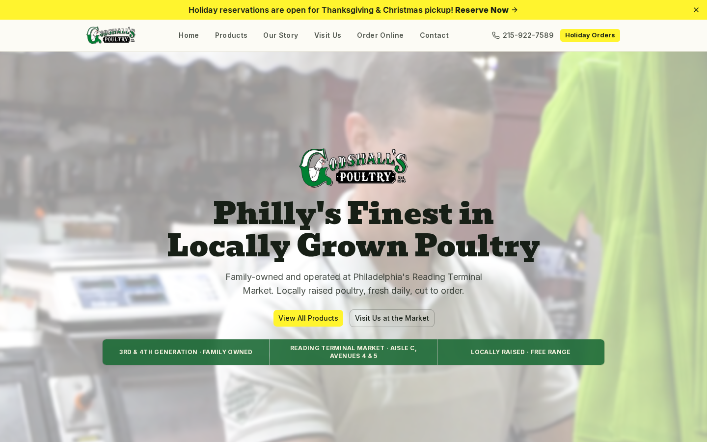
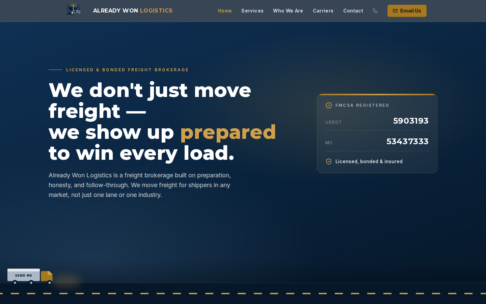

# Jesse Detweiler

I'm a full-stack engineer. I build the web apps small businesses run on: ordering systems, admin dashboards, and the sites their customers use.

## Stack

<table>
  <tr><td><b>Languages</b></td><td>  </td></tr>
  <tr><td><b>Frontend</b></td><td>  </td></tr>
  <tr><td><b>Backend & data</b></td><td>   </td></tr>
  <tr><td><b>Infra & quality</b></td><td>   </td></tr>
  <tr><td><b>AI</b></td><td></td></tr>
</table>

---

## Selected work

Most of my work is client code, so the repositories are private. The products are live, and I'm happy to walk through the code on a call.

### Godshall's Poultry: holiday ordering and operations
**[godshallspoultry.com](https://godshallspoultry.com)**

A public site plus a full holiday pre-order platform for a Reading Terminal Market poultry vendor.
- Customers reserve holiday orders online with live pickup-slot availability and per-holiday ordering cutoffs
- Staff admin panel for orders, pickups, prep lists, and stock levels, with order creation and editing
- Transactional confirmation emails (React Email + Resend) and Excel export for the shop floor
- Scheduled daily jobs via Vercel Cron

`Next.js` `TypeScript` `PostgreSQL` `Drizzle ORM` `Resend` `shadcn/ui` `Zod` `Vercel`

### Financial Guidance: adaptive financial literacy platform (in progress)
Personal project, actively in development

- Diagnostic assessment → adaptive routing → personalized scenario-based learning modules
- Embedded AI tutor (Claude API) with streamed responses and Socratic, non-advice guardrails
- Supabase auth with row-level security on every table; Zod-validated inputs at every boundary
- CI on every PR: lint, typecheck, Vitest unit tests, Playwright end-to-end tests, and a from-scratch migration replay; Sentry error monitoring

`Next.js` `TypeScript` `Supabase` `PostgreSQL` `Claude API` `Vitest` `Playwright` `GitHub Actions` `Sentry`

### Already Won Logistics: freight brokerage website
**[alreadywonlogistics.com](https://alreadywonlogistics.com)**

Marketing site for a freight brokerage, with service, carrier, and contact pages and smooth Framer Motion animation.

`Next.js` `TypeScript` `Tailwind CSS` `Framer Motion`

### Detweiler Contracting: carpentry business website
**[detweiler-contracting-llc.vercel.app](https://detweiler-contracting-llc.vercel.app)** · Quakertown, PA

Website for a local carpentry business, with services, project gallery, and contact pages.

`Next.js` `TypeScript` `Tailwind CSS` `Framer Motion`

---

## Currently
- Building a pre-order and pickup-scheduling platform for small shops
- Open to full-stack engineering opportunities
